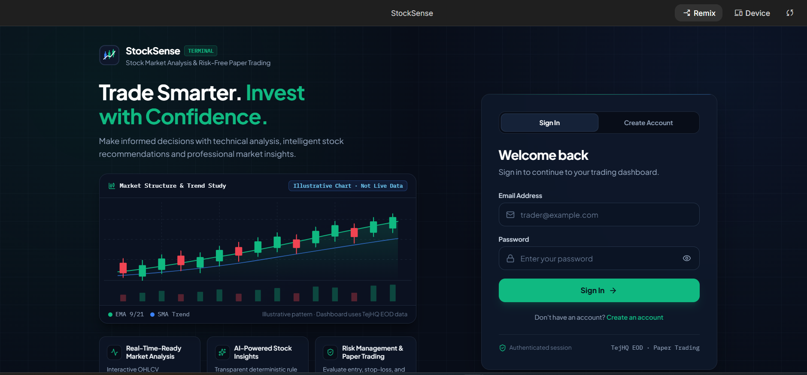
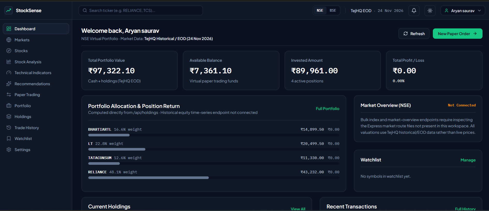
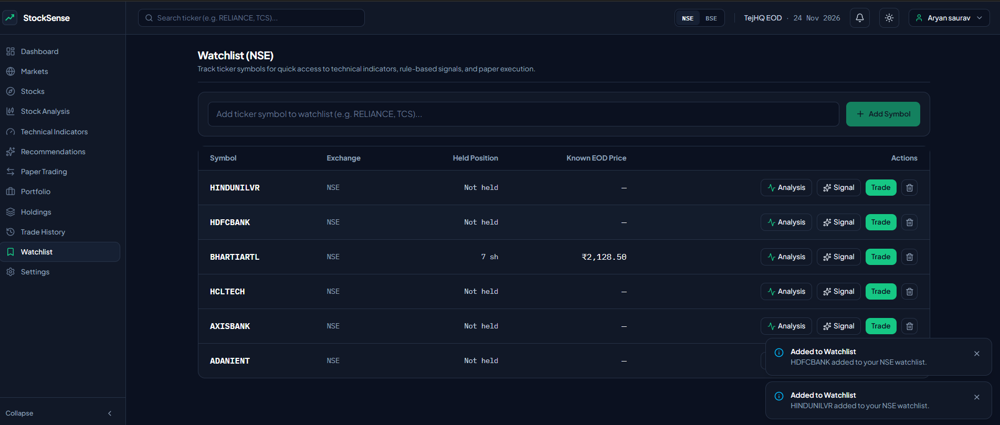
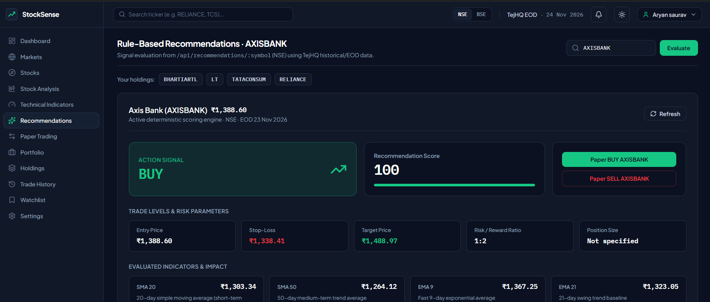
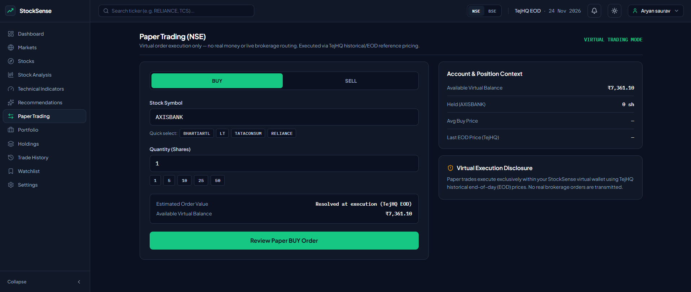
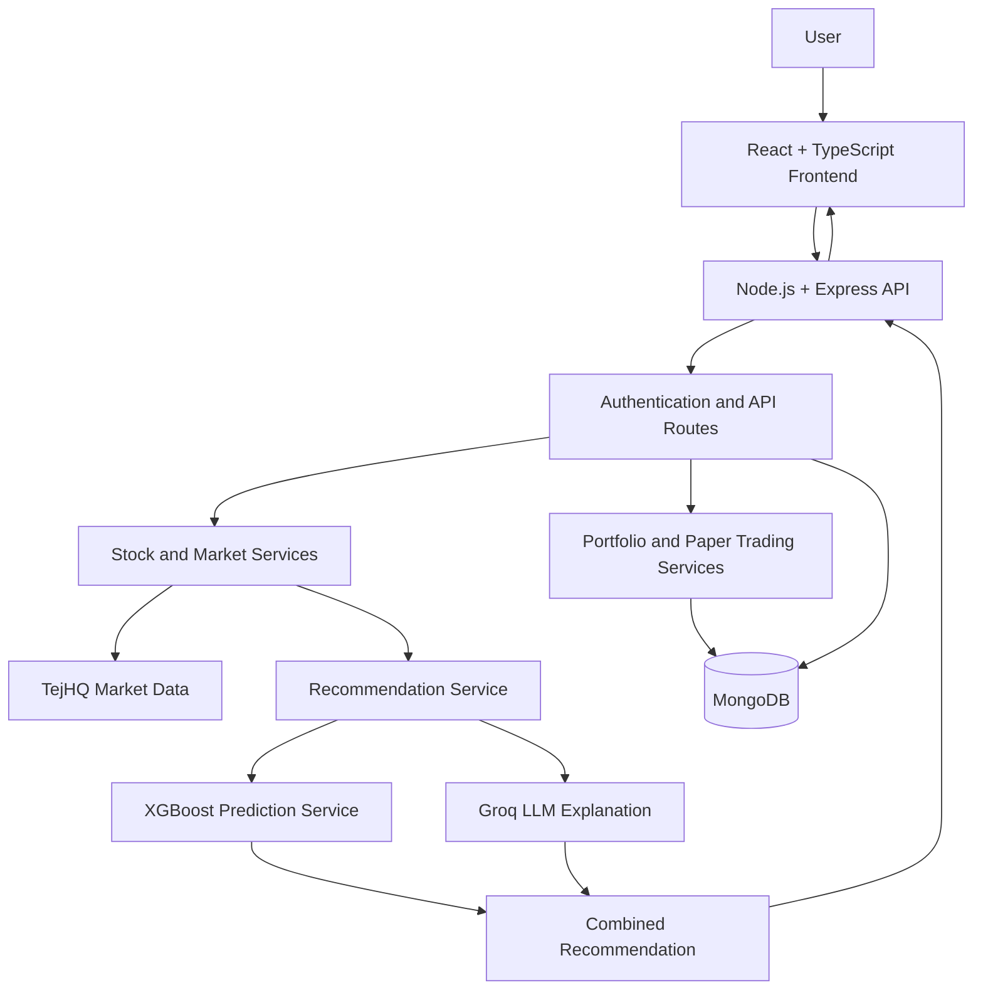
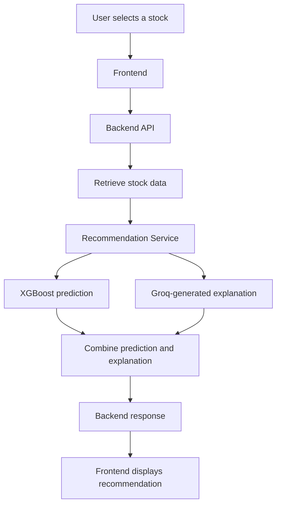
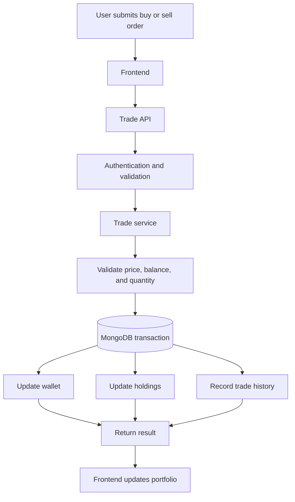

# StockSense — Stock Recommendation & Paper Trading Platform

StockSense is a full-stack stock market analysis and recommendation platform combining quantitative analysis, machine-learning predictions, and AI-generated explanations.

The application provides stock analysis, technical indicators, recommendations, watchlists, portfolio tracking, and simulated paper trading through a custom-built web interface.

## Screenshots

The image links below use the filenames currently present in the project's `screenshots/` folder.

### Login Page



### Dashboard



### Watchlist



### Recommendations



### Paper Trading



> **Screenshots still to add:** A separate Stock Analysis screenshot, a Portfolio screenshot, and (if desired) the second dashboard image. Once added, include them using their exact filenames.

---

## Features

- Stock market dashboard and stock exploration
- Stock analysis and technical indicators
- Machine-learning-based stock predictions
- AI-generated explanations for recommendations
- Watchlist management
- Portfolio and holdings tracking
- Simulated buy and sell transactions
- Wallet balance and trade history
- User authentication

## Architecture

### High-level architecture



### Recommendation request flow



### Paper-trading flow



### Architecture components

| Component | Responsibility |
|---|---|
| React + TypeScript | Frontend interface and user interactions |
| Node.js + Express | Backend API and application logic |
| MongoDB + Mongoose | Application data persistence |
| XGBoost / Python | Machine-learning predictions |
| Groq LLM | AI-generated explanations |
| TejHQ | Market data source |

## Technology Stack

**Frontend**
- React
- TypeScript
- Vite

**Backend**
- Node.js
- Express.js
- REST API
- JWT authentication

**Database**
- MongoDB
- Mongoose

**Machine Learning and AI**
- Python
- XGBoost
- Groq LLM

**Market Data**
- TejHQ

## Project Structure

```text
StockMarketApp/
├── frontend/
│   ├── src/
│   │   ├── api/
│   │   ├── components/
│   │   ├── context/
│   │   └── App.tsx
│   ├── package.json
│   └── vite.config.ts
├── src/
│   ├── config/
│   ├── controllers/
│   ├── middleware/
│   ├── models/
│   ├── routes/
│   ├── services/
│   └── scripts/
├── app.js
├── package.json
└── README.md
```

## Getting Started

### Prerequisites

- Node.js and npm
- MongoDB
- Python, if running the machine-learning service separately

### 1. Clone the repository

```bash
git clone https://github.com/Aryan-droid1/Stock-Recommandation-app.git
cd Stock-Recommandation-app
```

### 2. Install backend dependencies

```bash
npm install
```

### 3. Configure backend environment

Create a `.env` file in the project root and add the environment variables required by your backend. For example:

```env
PORT=5000
MONGODB_URI=your_mongodb_connection_string
JWT_SECRET=your_jwt_secret
```

Add any other credentials required by your configured market-data and AI services. Do not commit `.env` or expose API keys.

### 4. Start the backend

```bash
npm start
```

The backend is expected to listen on port `5000`, unless configured otherwise.

### 5. Install frontend dependencies

Open another terminal:

```bash
cd frontend
npm install
```

Configure the frontend API base URL using the environment variable or configuration expected by the frontend API client.

### 6. Start the frontend

```bash
npm run dev
```

Open the local development URL printed by Vite.

## Paper Trading

Paper trading simulates stock transactions using virtual funds. It supports buying and selling, wallet balance tracking, holdings, portfolio valuation, and trade history. It does not place real market orders.

## Disclaimer

This project is for educational and research purposes. Stock predictions and AI-generated recommendations are not guaranteed to be accurate and should not be treated as financial advice.

## Author

**Aryan Saurav**

- GitHub: [Aryan-droid1](https://github.com/Aryan-droid1)
- Repository: [Stock-Recommandation-app](https://github.com/Aryan-droid1/Stock-Recommandation-app)
